# CADRecover

**A Bittensor subnet that turns engineering drawings into editable, verified parametric CAD.**

Miners turn a dimensioned drawing into parametric [build123d](https://github.com/gumyr/build123d) code. Validators rebuild that code in a sandbox and pay only for parts that match the drawing to a tenth of a millimetre **and** stay correct when a hidden parameter changes.

Live site: **[cadrecover.vercel.app](https://cadrecover.vercel.app)** (static build; the live dashboard pages need the read API, see [Run it](#run-it)) · Testnet: **netuid 605** · Protocol 0.3.0 · Scoring v2.1

---

## The problem

Factories keep drawers of engineering drawings for parts nobody can make anymore. The 3D files are gone, the supplier is gone, and a machinist needs CAD to cut a replacement. Redrawing one part by hand costs roughly **$150 to $300** of an engineer's time, and a plant can have thousands.

Generic image-to-3D models do not solve this. They produce a mesh that *looks* right: no dimensions, no tolerances, nothing a CNC machine can use, and nothing you can edit when the next revision moves a hole.

## Why we built it

The useful output is not a shape, it is a **program**: parametric CAD where `bolt_circle_diameter` is a real variable and every dependent feature follows it. That output is also *verifiable*, which is what makes it a good fit for Bittensor:

- A validator can **rebuild** the code and **measure** it against hidden ground truth. No human judging, no LLM-as-judge.
- A validator can **change a parameter** the miner never saw and check the part is still right. Code that hard-codes the drawing fails; code that captures design intent passes.
- Because the answer is checkable, the network can pay for correctness and let open competition improve the models.

## How it works

Two tracks share one validator, one scorer and one chain.

| | Track A: live rounds | Track B: king of the hill |
| --- | --- | --- |
| Miner submits | an answer per drawing, over a signed HTTP job | **fine-tuned open vision model weights** (Hugging Face repo + pinned revision), committed on chain |
| Who runs inference | the miner | the validator, on **Chutes** (Bittensor subnet 64) |
| Who wins | every miner above the quality floor, weighted by score | only the champion; a challenger must win by **more than 2 points** on the same hidden drawings |
| Anti-cheat | committed Docker engine, re-run offline by auditors | weight fingerprint (sorted LFS SHA-256 of safetensors), same fresh tasks for both sides |

### Validation mechanism

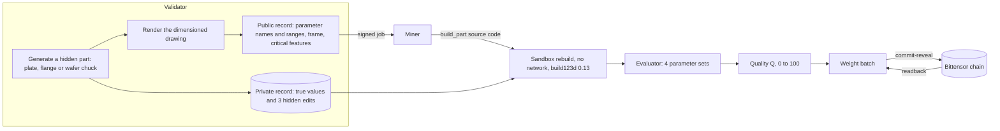

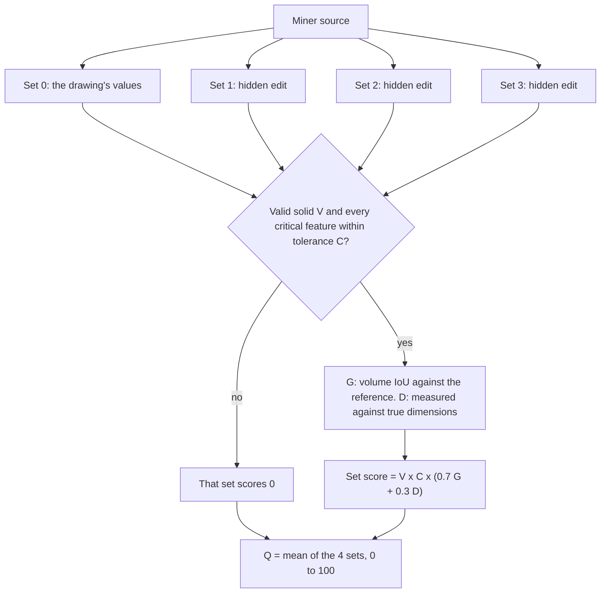

The rules that make it hard to game ([PRD.md](PRD.md), scoring v2.1):

- **Every parameter set counts equally:** the drawing's values plus 3 hidden edits.
- **A missing or misplaced critical feature zeroes that set.** A part that looks right but has one hole 0.4 mm off scores 0 for that set.
- **Hidden edits are discriminative:** each moves a feature by more than 5× tolerance, and the reference's self-overlap stays below 0.85, so hard-coding the drawing cannot pass.
- **Self-test:** an exact program scores 100, one that ignores edits scores 25, a wrong critical feature scores 0. The quality floor for weights is 50.

### Track B: one match

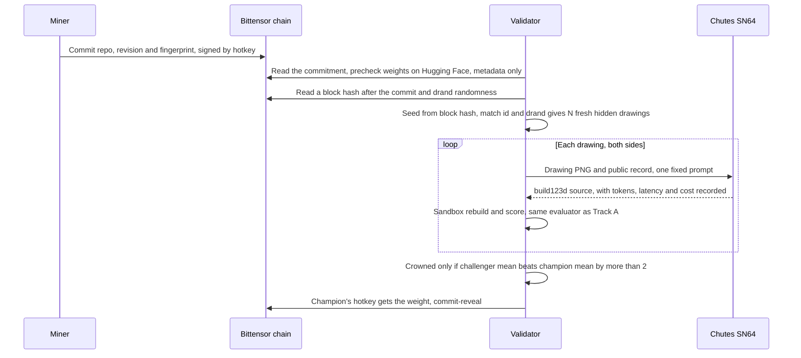

## It runs: proof on Bittensor testnet 605

Every row below was read back from the chain. Open a block in [Polkadot.js Apps on testnet](https://polkadot.js.org/apps/?rpc=wss%3A%2F%2Ftest.finney.opentensor.ai%3A443#/explorer) to check it.

| What | Call | Extrinsic | Block |
| --- | --- | --- | --- |
| Track B: champion weight commit (Qwen3.8 crowned, 66.67) | `commit_timelocked_mechanism_weights` | `0x743b7a164cef933252aaf83cac33fad73392af9a9c394d3d8889c47e01e2b37a` | [8,338,548](https://polkadot.js.org/apps/?rpc=wss%3A%2F%2Ftest.finney.opentensor.ai%3A443#/explorer/query/8338548) |
| Track A: round weight commit (1 miner, Q 100) | `commit_timelocked_mechanism_weights` | `0x913a1c5026de1b7fa91da761d00e2ae427e0649040c5369c7b4d237427f97150` | [8,338,660](https://polkadot.js.org/apps/?rpc=wss%3A%2F%2Ftest.finney.opentensor.ai%3A443#/explorer/query/8338660) |
| Track A: round 2 weight commit (5 miners: 100 / 100 / 25 / 0 / 0) | `commit_timelocked_mechanism_weights` | `0x6a77064427a10d0642118297f7c0365fd3ce82766f36d72e5eb5579c80ba7d00` | [8,339,024](https://polkadot.js.org/apps/?rpc=wss%3A%2F%2Ftest.finney.opentensor.ai%3A443#/explorer/query/8339024) |
| Register miner uid 1 | `burned_register` | `0x853e795d94ade44a5b698abe342138c02a16f69eb873f87ef178c9d171aa011b` | [8,338,520](https://polkadot.js.org/apps/?rpc=wss%3A%2F%2Ftest.finney.opentensor.ai%3A443#/explorer/query/8338520) |
| Publish miner uid 1's endpoint | `serve_axon` | `0x539021127b617211772a870ce6f251c13ffaadb77fa6b9ca6e34b7ce86afe21f` | [8,338,528](https://polkadot.js.org/apps/?rpc=wss%3A%2F%2Ftest.finney.opentensor.ai%3A443#/explorer/query/8338528) |
| Fund miner uid 1's coldkey | `transfer_keep_alive` | `0x03f36e167e064e1f0326f4e92c17def8f5c3a17e5caab52f24ed282f060bd02d` | [8,338,516](https://polkadot.js.org/apps/?rpc=wss%3A%2F%2Ftest.finney.opentensor.ai%3A443#/explorer/query/8338516) |

Both Track B and the first Track A commits have been **revealed** on chain (readback `{uid 0: 1.0}` and `{uid 1: 1.0}`). Twelve more miner setup transactions (uids 2 to 5) are listed on the dashboard's Chain page.

The Track A testnet miners are labelled reference mocks (`mock-oracle`, `mock-noisy`) and diagnostics (`diag-constant`, `diag-wrong-holes`, `diag-crash`): they prove the scorer separates 100 / 25 / 0, not that a model read the drawing. The Track B testnet scores come from real vision models.

## Built on the Bittensor ecosystem

| Subnet | Role in CADRecover | Status |
| --- | --- | --- |
| **Chutes** (SN64) | Inference for Track B: every model on the hill runs on Chutes; the validator only scores | **In use**, proof below |
| **Lium** (SN51) | GPU rental for miners to fine-tune vision models before committing them to the hill | **In use** |
| **Hippius** (SN75) | Decentralised storage for drawings, reference GLBs and released challenge data | **In use** |

### Chutes: proof of use

Measured from the validator's own spend ledger and provider-response log (`hill_spend`, `hill.provider_response` events):

| | |
| --- | --- |
| Charged inference calls | **44** |
| Actual cost | **$0.183** (244,008 prompt + 99,774 completion tokens) |
| Calls with a logged Chutes response id | 37 (e.g. `chatcmpl-b690c5ef1cae0de6`, `67630d088c3e41eba4a2e86b02ad4c08`) |
| Failed calls held at their worst-case bound | 4 ($0.254 reserved, never counted as charged) |
| Models called | `gemma-4-31B-turbo-TEE`, `Qwen3.8-27B-TEE`, `Qwen3.6-27B-TEE`, `Qwen3.5-397B-A17B-TEE`, `Kimi-K2.6-TEE` |
| Hill matches decided | 8 (6 localnet, 2 testnet), 4 crownings |

Every call goes through one **budget guard** (lifetime cap $3, $0.50 per match, conservative reservations before each request). The harness sends one fixed prompt to every model, so the competition is the weights, not the prompt.

Custom miner weights on Chutes (build, deploy, run, delete) are implemented and tested against a mocked Chutes API, and disabled by default: building images needs a funded Chutes account.

## Screenshots

All taken from the running app on testnet data, except where noted.

<table>
  <tr>
    <td width="33%">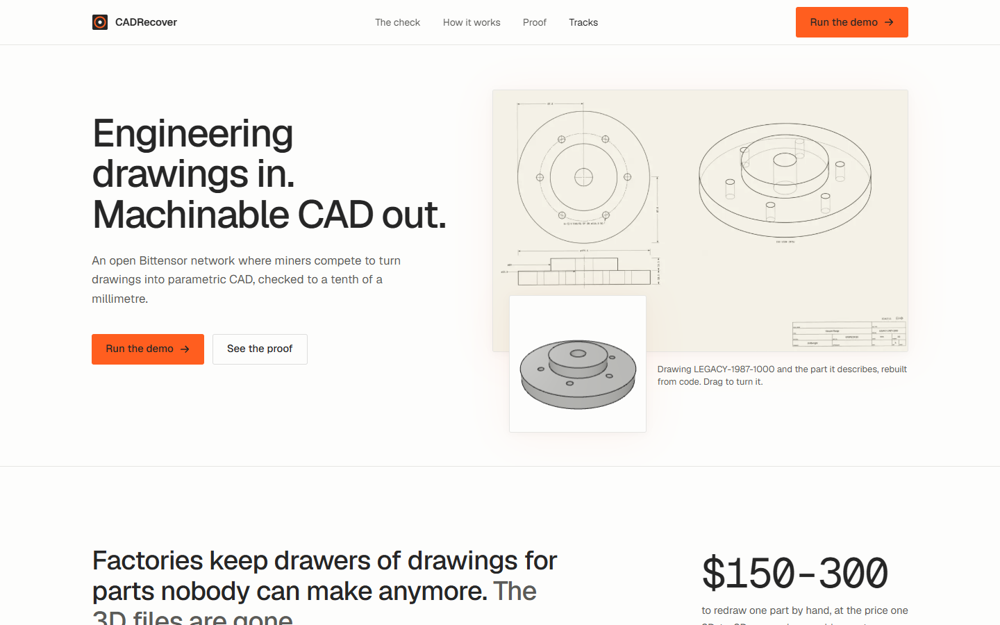<br/><sub>Landing: real drawing, rebuilt part</sub></td>
    <td width="33%">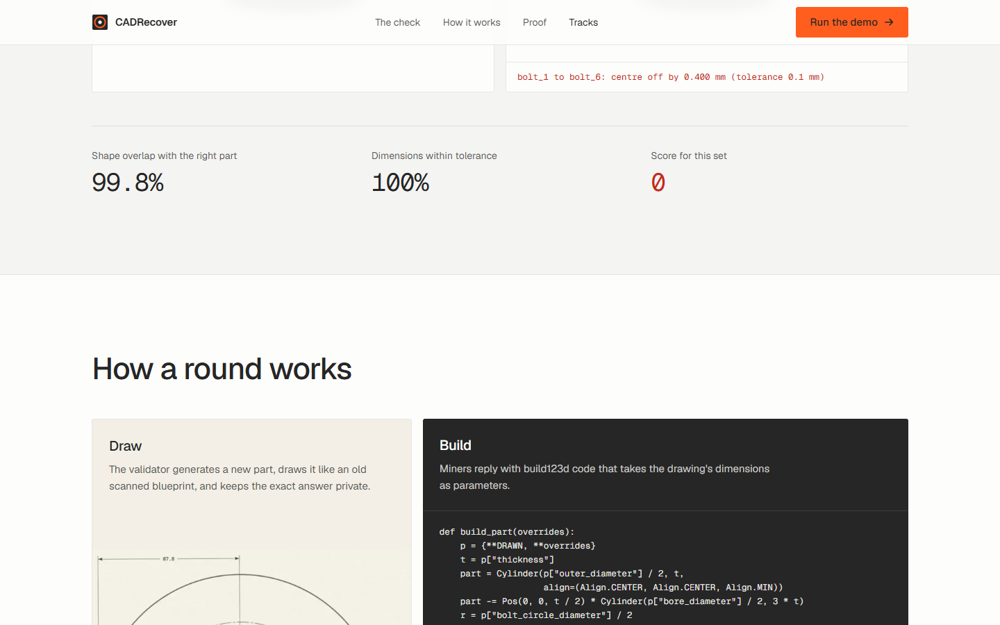<br/><sub>Landing: the zero-score check</sub></td>
    <td width="33%">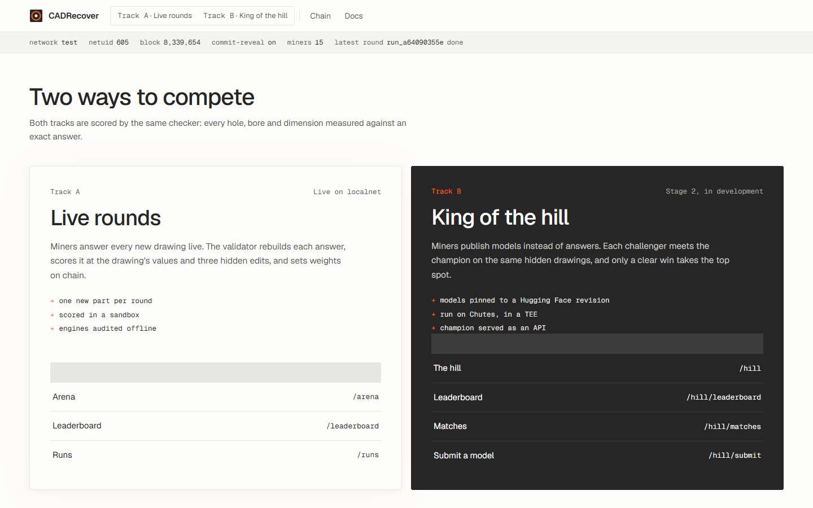<br/><sub>Two tracks</sub></td>
  </tr>
  <tr>
    <td width="33%">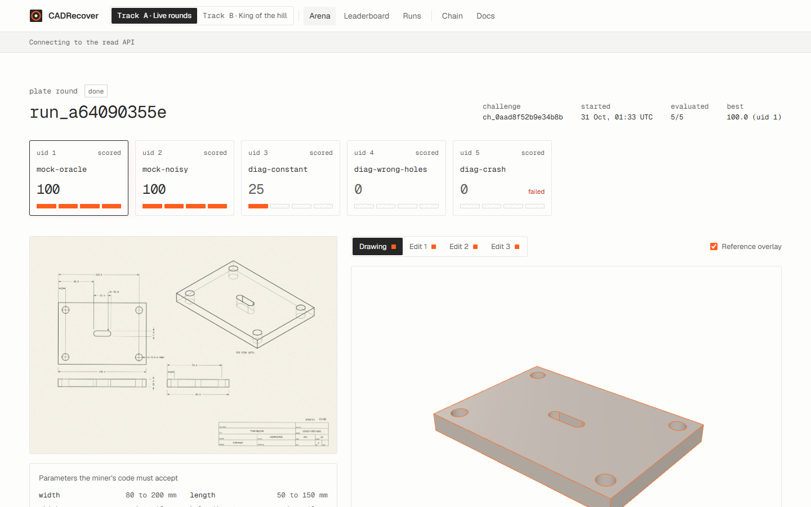<br/><sub>Track A round on testnet 605</sub></td>
    <td width="33%">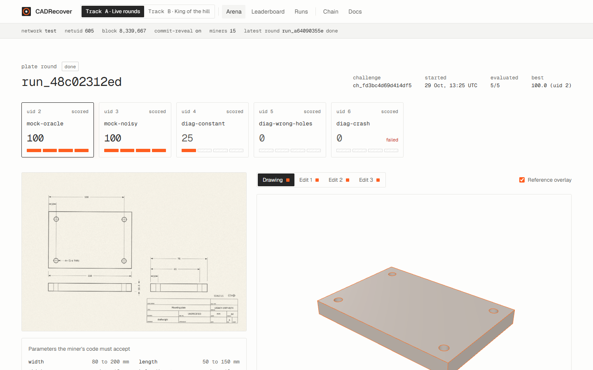<br/><sub>Arena: drawing, scores, 3D part (localnet round)</sub></td>
    <td width="33%">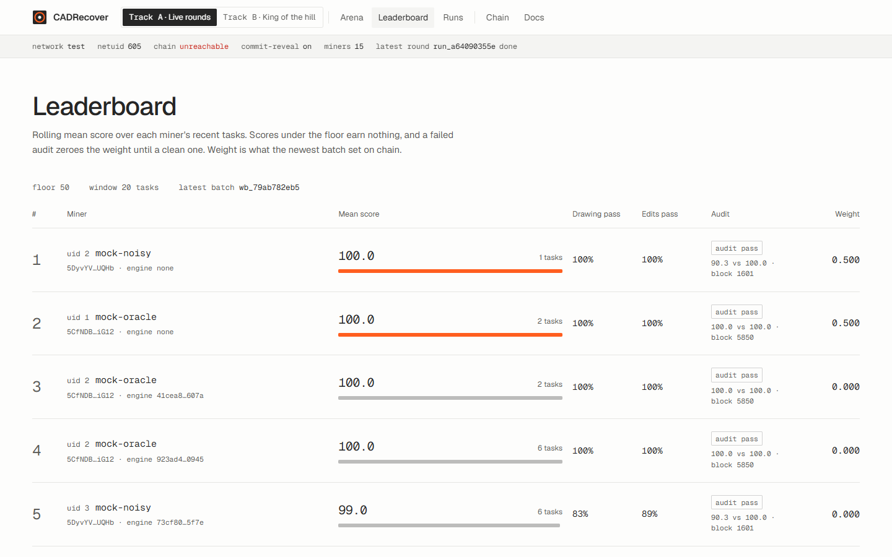<br/><sub>Track A leaderboard</sub></td>
  </tr>
  <tr>
    <td width="33%">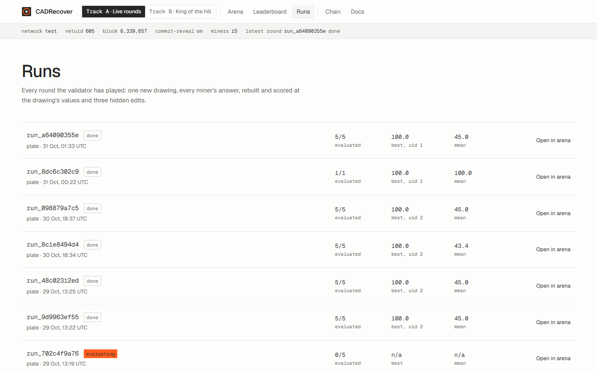<br/><sub>Every round</sub></td>
    <td width="33%">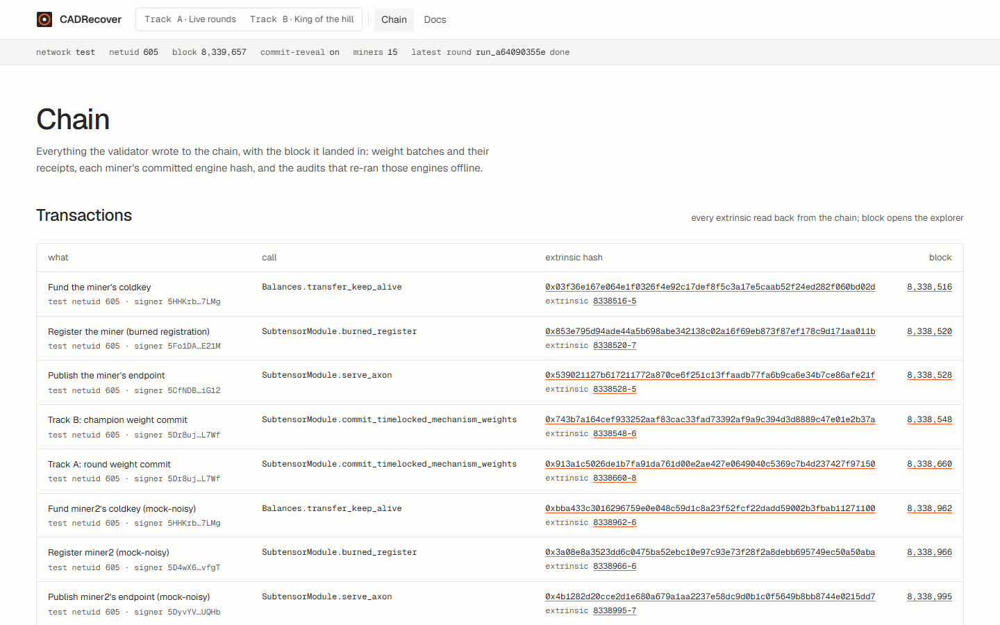<br/><sub>Testnet transactions with explorer links</sub></td>
    <td width="33%">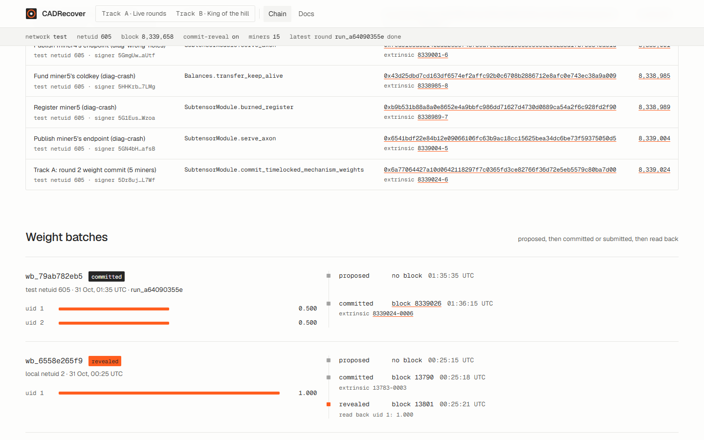<br/><sub>Weight receipts: commit, reveal, readback</sub></td>
  </tr>
  <tr>
    <td width="33%">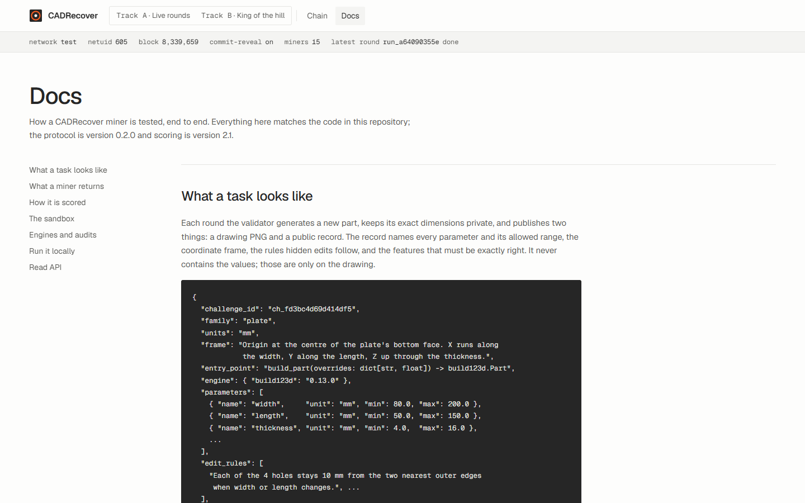<br/><sub>Docs: how a miner is tested</sub></td>
    <td width="33%">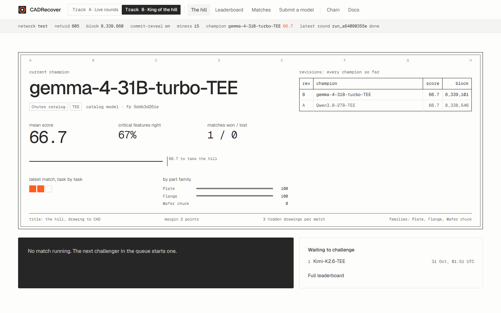<br/><sub>Track B: the hill</sub></td>
    <td width="33%">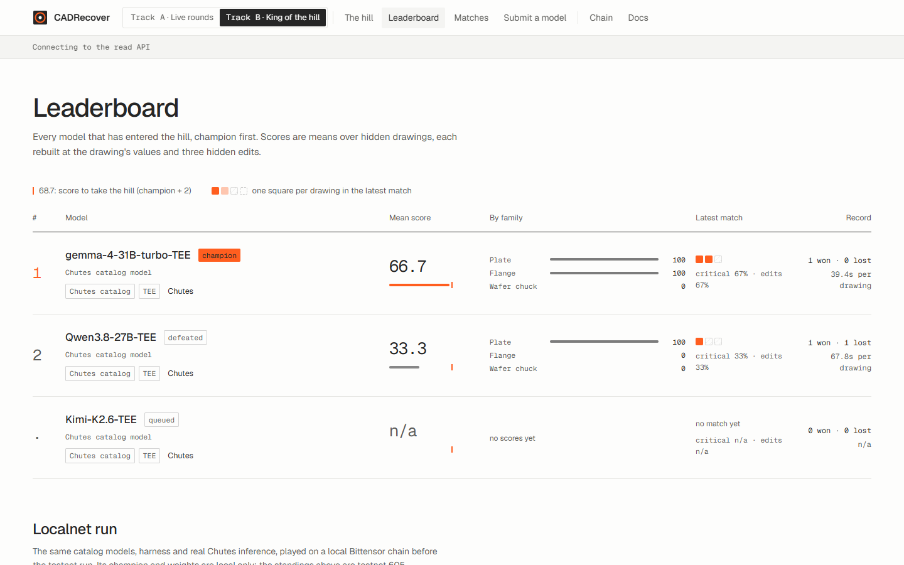<br/><sub>Hill leaderboard: testnet + localnet run</sub></td>
  </tr>
  <tr>
    <td width="33%">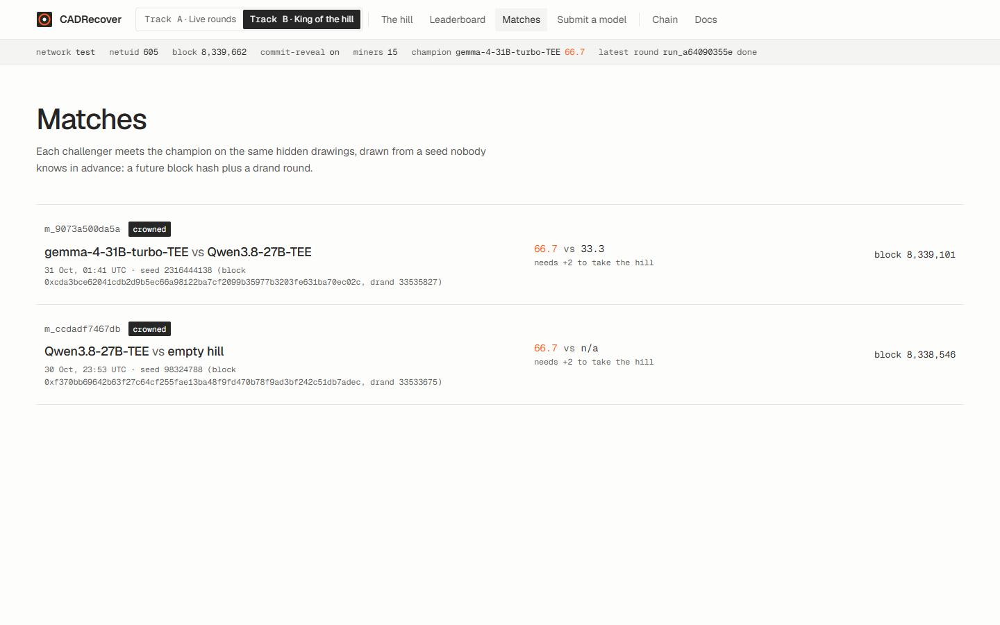<br/><sub>Every match</sub></td>
    <td width="33%">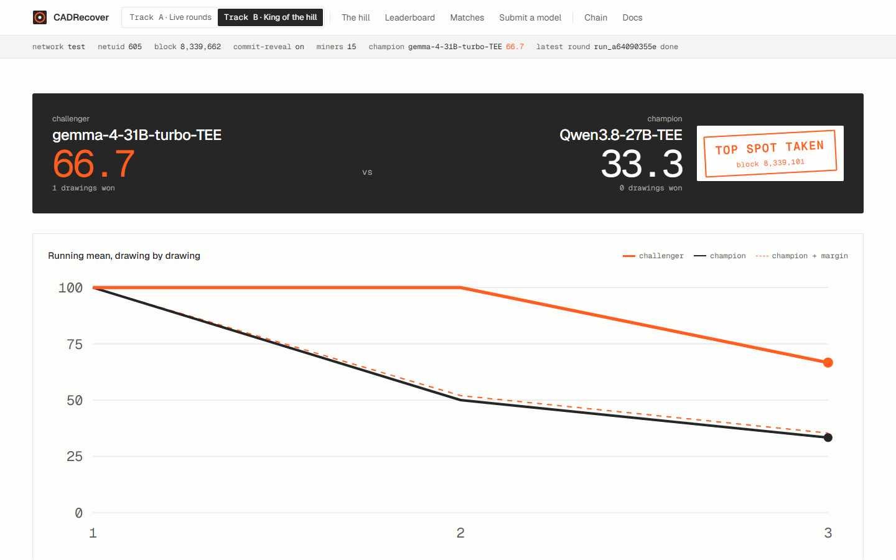<br/><sub>Gemma dethrones Qwen3.8 on testnet</sub></td>
    <td width="33%">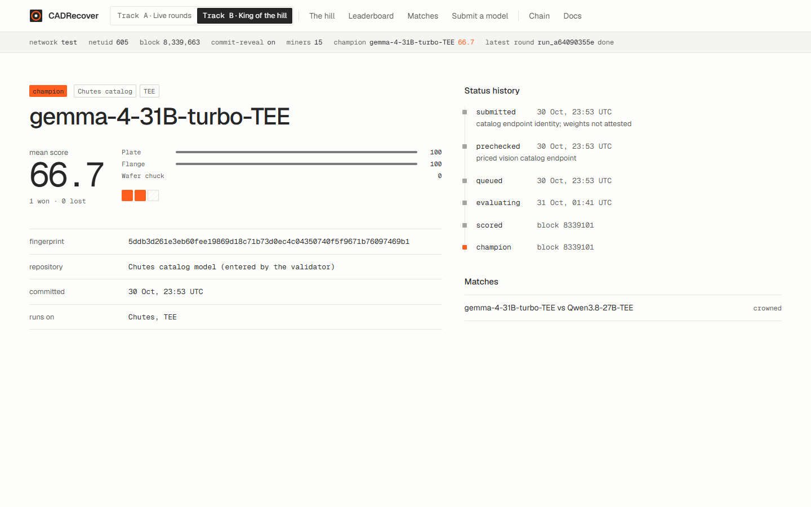<br/><sub>Model page</sub></td>
  </tr>
  <tr>
    <td width="33%">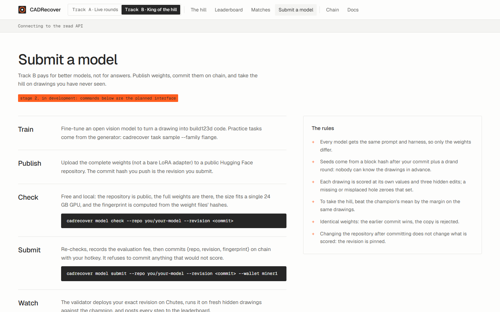<br/><sub>How a miner submits a model</sub></td>
  </tr>
</table>

## Repository layout

```
src/cadrecover/
  protocol/      shared records: challenges, jobs, evaluations, weight batches, hill models and matches
  challenges/    part families (plate, flange, wafer chuck; vacuum chamber in progress), drawings, hidden edits
  evaluation/    the scorer: rebuild, measure, V / C / G / D / Q per parameter set
  execution/     sandboxed rebuild of untrusted miner source
  validator/     Track A rounds, aggregation; validator/hill/ for Track B (precheck, Chutes runner, budget, matches)
  miner/         signed FastAPI miner, strategies, build123d templates
  chain/         bootstrap (localnet), commitments, weights with commit-reveal and readback
  audit/         re-run a miner's committed engine offline on fresh hidden tasks
  storage/       SQLite schema and writers
  api/           read-only FastAPI for the dashboard (OpenAPI in docs/api/)
  cli.py         `cadrecover` command line
apps/web/        Next.js dashboard (Track A arena, Track B hill, chain receipts, docs)
images/          Docker images: CAD worker, drawing worker, sandbox
tests/           services / cad / drawing suites, one per locked environment
docs/api/        OpenAPI schema and the Track B read API contract
notes/           the build log: each agent's phase checklist with evidence
```

## Run it

Linux or WSL (bittensor v11 has no native Windows support). Networks are `local` or `test` only.

```bash
make envs           # three locked environments under ~/.cadrecover/envs
make test           # services, cad and drawing suites
make demo           # localnet + 5 miners + validator rounds + audit + weights (DEMO_HEADLESS=1 for plain output)
make api            # read API on 127.0.0.1:8000

cadrecover task sample --family flange --out demo/       # what a miner sees
cadrecover score solution.py --task <challenge_id>        # score a solution exactly as validators do
cadrecover hill run --network local --catalog --tasks 3   # Track B catalog match (needs CHUTES_API_KEY)

cd apps/web && npm install && npm run dev                  # dashboard on localhost:3000
```

Keys, wallets, `.env` and ground truth never go in git; runtime state lives in `~/.cadrecover`.

## More

- [PRD.md](PRD.md): product, mechanism and architecture (scoring v2.1)
- [REVIEW.md](REVIEW.md): design review and open risks
- [docs/api/hill-contract.md](docs/api/hill-contract.md): Track B read API contract
- [notes/](notes/): phase-by-phase build log with evidence
